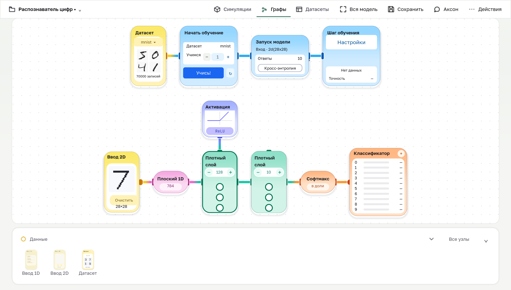
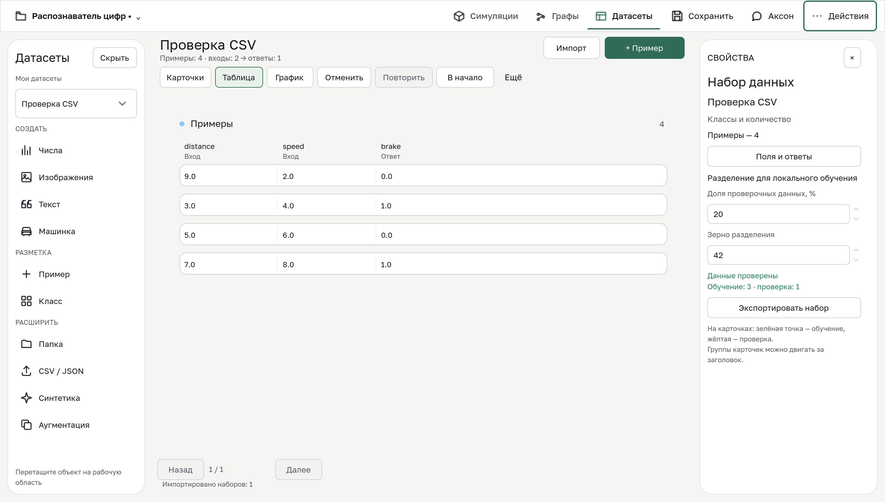
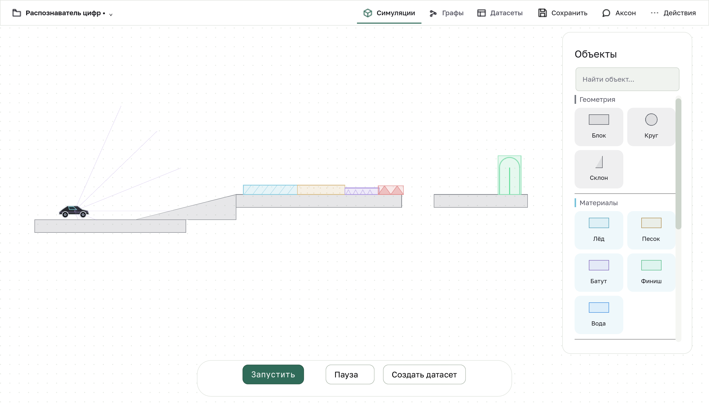

# Проверка builder — 22 октября 2026

Проверяется Godot-приложение из ветки `codex/claude-design-integration`, а не сайт команды. Базовая опубликованная версия — `d9d32dd3430e56a2f7d4941f6623efb7f7923108`.

## Почему локальная демонстрация отличалась от запуска исходников

Сравнение показало совпадение UI-кода. Демонстрационный сценарий открывал Digits, явно упорядочивал граф и обходил обычный старт. При обычном запуске включался школьный pilot-режим; примеры содержали координаты для старых размеров карточек. Кроме того, Git не содержит установленный Python runtime, необходимый для локального обучения.

Теперь обычный запуск открывает builder. Pilot включается явно через `--pilot` или feature экспортируемой сборки. Новая копия встроенного примера упорядочивается и вписывается автоматически. Сохранённые пользовательские координаты при повторном открытии не меняются. Подготовка Python описана в [инструкции runtime](../local_runtime/README.md).

## Исправления и воспроизведения

| Приоритет | Сценарий до исправления | Исправление и регрессия |
|---|---|---|
| P1 | Нечисловая строка в числовой колонке JSON превращалась в 0 | Проверка типа и конечности; ошибка с номером строки/столбца. `test_json_dataset_integrity` |
| P1 | JSON round-trip терял параметры симуляции и семейства примеров | Сохранение metadata, ролей, классов и семейства; полная точность чисел; неподдерживаемые значения отклоняются до перезаписи файла |
| P2 | Копирование настроенного слоя → undo → redo сбрасывало параметры и позицию | Creation snapshot обновляется после копирования конфигурации. `test_duplicate_node_history` |
| P2 | Новый встроенный пример открывался с перекрытыми и обрезанными узлами | Arrange/fit только после успешного создания новой копии. `test_builtin_copy_initial_layout` проверяет также ручные позиции после save/reopen |
| P2 | Палитра оставалась под модальным стартовым диалогом | Совместное владение скрытием, восстановление после вложенных диалогов и handoff; shell и вкладка учитывают это состояние. `test_ui_manager_dialog` |
| P2 | Удалённый напрямую диалог оставался в реестре до следующего кадра | Синхронная очистка реестра при уничтожении; проверка немедленного lookup |
| P2 | Detached плитки сеток и шаблоны сообщений удерживали UI-объекты после удаления владельца | Освобождение принадлежащих владельцу шаблонов и пулов; lifecycle-регрессии с WeakRef до/после |
| P2 | Сворачивание настроек при открытом списке оставляло popup вне карточки | Список закрывается штатной анимацией, возвращается владельцу и затем скрывается; регрессия проверяет повторное открытие и сохранение значения |
| UX | Все типы узлов и помощник одновременно занимали полотно | Шесть групп палитры, поиск «Все узлы», Аксон открывается явно |
| UX | Меню повторяло видимые действия; параметры обучения постоянно раскрыты | Overflow содержит только скрытые/второстепенные действия; расширенные параметры под «Настройки» |
| UX | Название классификатора и ReLU имели слабый контраст | Цвета текста берутся из общих семантических токенов; состояния и редактирование сохранены |

Палитра: жёлтый — данные и ввод; зелёный — обучаемые слои; фиолетовый — операции без весов; розовый — изменение формы; оранжевый — вывод; синий — обучение. CSV остаётся форматом значений таблицы; полную схему и настройки сохраняет JSON. Это различие указано перед экспортом.

Встроенный fallback конфигурации pilot enrollment удалён; в исходниках он должен оставаться пустым. Конфигурация pilot задаётся внешним окружением.

## Проверка

Финальная проверка: 117 Godot-сценариев прошли, код завершения каждого — 0; неожиданных ошибок движка нет. Единственный ожидаемый ERROR относится к отрицательной проверке недоступного каталога autosave. Python suites: 130 passed, 1 skipped, 42 subtests passed. Отдельно: 4 теста worker, проверка реестра и 21 сгенерированная сцена. Пропущен тест состава embedded runtime: установленная среда разработки не является готовым платформенным runtime-пакетом. Новые тесты зарегистрированы в runner.

Нативный smoke завершился с кодом 0 и сохранил 28 кадров. Обычный старт в отдельном чистом профиле также завершился с кодом 0 без ошибок. Независимый review проверил исправления и снимки; его вывод ограничен перечисленными сценариями.

Реальный локальный сценарий использует синтетический набор из 48 строк: production Godot → Python worker → обучение → предсказание → экспорт ONNX. Из 48 строк в обучающую выборку вошли 38. ONNX checker прошёл для обычного и остановленного задания; максимальная разница предсказания Godot и CPU inference экспортированной модели составила 0.0; отдельно проверяется остановка задания. Это проверка интеграции, а не доказательство качества модели на реальных данных.

Нативные снимки получаются из Godot: первый запуск в чистом профиле, меню и галерея; граф, таблица, симуляция, ошибки/пустые состояния, меню с клавиатуры, размеры 375–1440 логических px. При уменьшении окна для общего вида применяется доступная команда «Вся модель»; редактирование большого графа требует масштабирования и панорамирования.

## Реальные экраны

Граф после команды упорядочивания и Fit (без вымышленных прогнозов):

Таблица синтетического CSV после редактирования:

Рабочее пространство симуляции:

## Границы проверки

- В следующем этапе подключён [локальный маршрут настройки и экспорта EV3](ev3-export-workflow.md). Живое подключение из интерфейса, перенос программы и физический EV3 остаются непроверенными; первоначальная проверка этого отчёта их не покрывала.
- Серверные ответы Аксона и авторизованные account/pilot-сценарии требуют внешних систем; здесь они не подтверждены.
- Windows manifest проверяется тестами, но Windows installer и запуск на Windows в этой проверке не выполняются.
- Симуляция проверяется нативным запуском/паузой и компонентными тестами. Полный пользовательский цикл симуляция → генерация → обучение → управление реальным устройством не заявляется.
- JSON numeric literals подчиняются числовой точности парсера Godot; точные целые int64 можно передать строками в колонке `:num`.
- Удобство для детей оценено по интерфейсу и сценариям; пользовательское исследование с детьми не проводилось.
