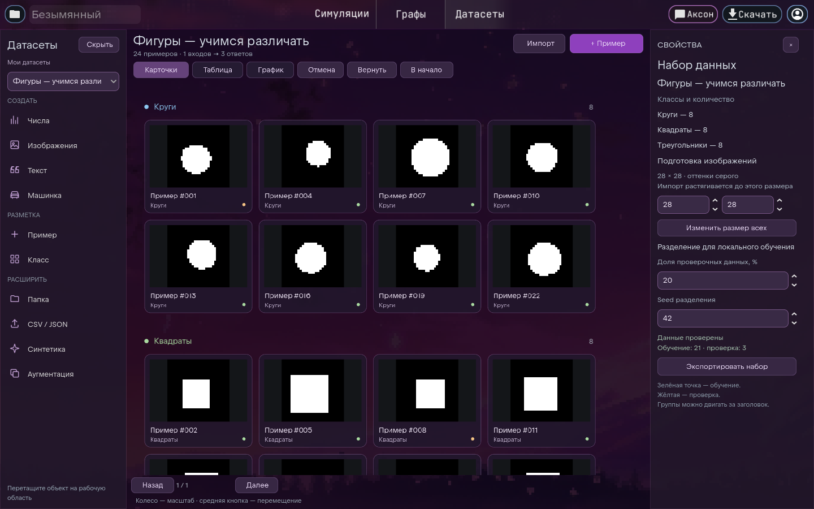
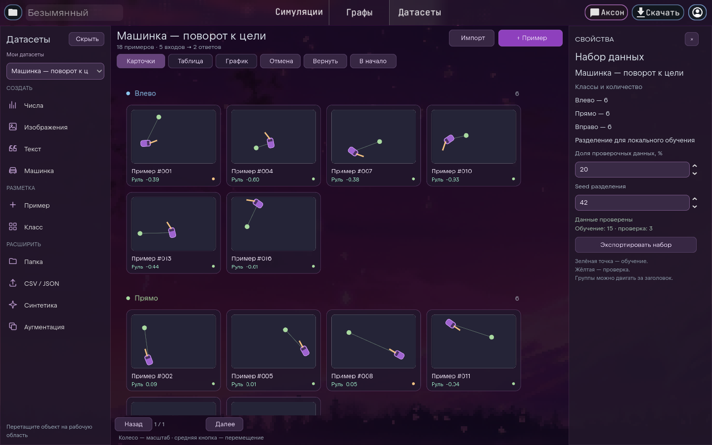

# Визуальная мастерская данных

Вкладка «Датасеты» заменяет старую таблицу с редактором кода. Слева — палитра,
в центре — рабочая область, справа — свойства выбранного примера или набора.
Кнопки используют `UIAdapter` и `BlockComponent`; элементы палитры наследуют
`NodePaletteItem` (`scripts/dataset_tab.gd`, `scripts/data_workspace/palette_item.gd`).
Сетки примеров наследуют существующий `GridVisualiser`, как `ProjectGrid` и
`FileGrid`: используют его пул плиток, индекс карточек и механизм наведения
и выделения с локальным оформлением вкладки. Карточки — `PanelContainer`; при обновлении сетка и плитки
переиспользуются (`scripts/data_workspace/sample_grid.gd`).

Фон вкладки — общий `scenes/bg.tscn` с сакурой; он активируется и выключается
вместе с вкладкой, а прозрачная рабочая область показывает штатное оформление.
База версии — ветка `dev`, коммит `573dc78`; изменения экспериментальных
языковых нодов из других веток не включены.

Оформление вкладки адаптировано из предоставленных HTML-макетов
`neuralese_datasets_mockup.html` и `neuralese_data_simple.html`: фиолетовые
кнопки с заливкой, спокойный шрифт, строковая палитра с SVG-иконками,
скруглённые карточки и поля ввода. Это локальная тема мастерской, применяемая
к существующим `BlockComponent`, `UIAdapter` и `GridVisualiser`; общая тема
остальных вкладок не изменяется. Группы идут сверху вниз, количество колонок
карточек подстраивается под ширину рабочей области.

## Работа с примерами

1. Выберите шаблон: числа, изображения, текст или машинка.
2. Добавьте пример или класс из палитры. Объекты можно перетаскивать на область.
3. Нажмите карточку для изменения полей. Ctrl добавляет карточку к выделению.
4. Перетащите карточку в другой класс для изменения метки.
5. Перемещайте группы за заголовок; средняя кнопка перемещает область, колесо
   меняет масштаб. Для больших наборов доступны страницы по 96 карточек.

Виды «Таблица» и «График» показывают те же данные. График использует первые
два числовых признака. «Поля и ответы» позволяет переименовывать и добавлять
числовые входы; для числовых задач метки можно заменить числовым ответом.
Изменения примеров поддерживают отмену и повтор.

## Импорт и хранение

Выберите папку, CSV/TSV/JSON или перетащите файлы из проводника. Подпапки
изображений и текстов становятся классами. Сначала показывается предпросмотр:
данные добавляются только кнопкой «Добавить в мастерскую».

Поддерживаются PNG, JPEG, WebP, BMP, TXT и MD; CSV с кавычками, JSON-массивы
объектов и переносимый JSON Neuralese. Последний столбец таблицы — ответ:
строковые ответы становятся классами, числовые остаются числами.
Изображения растягиваются до единого размера (изначально 28 × 28) и переводятся
в серые. Размер всего набора можно изменить в свойствах. Цветные наборы этот
редактор пока не создаёт.

Импорт ограничен 20 000 файлами, таблица — 64 МБ, отдельный текст — 1 МБ.
Скрытые папки и символьные ссылки на папки пропускаются. Ошибки показываются
в предпросмотре. Экспорт: CSV для чисел/текста, JSON с PNG для изображений.
Плотные числовые наборы сохраняют существующее packed-хранение, изображения
внутри проекта используют существующее RLE-сжатие. Большие публичные датасеты
не включены в поставку (`document.gd`, `import_export.gd`, `dataset_tab.gd`).

## Синтетика, аугментация и обучение

Синтетические шаблоны воспроизводимы по seed: числовые кластеры, простые фигуры,
положение машинки и поворот к цели. Это примеры по математическим правилам;
генерация не запускает физическую симуляцию сцены. После изменения классов фигур
их генерация отключается, чтобы не создавать неверную разметку.

Аугментация добавляет копии: сдвиги/шум изображений, шум числовых входов,
зеркальное состояние машинки с соответствующим изменением поворота. Текстовая
аугментация не реализована. История ограничена 12 снимками.

Доля проверки и seed применяются при **локальном обучении**. Исходный пример
и его вариации имеют общий идентификатор семейства и остаются в одной части
набора. `scripts/run_manager.gd` передаёт отдельные обучающие и проверочные
массивы; `local_runtime/neuralese_local/dataset_store.py` восстанавливает форму
изображений NCHW. Удалённый API находится в другом репозитории.

Реализация: `scripts/data_workspace/`; проверки: `test_data_workspace_document.gd`,
`test_data_workspace_ui.tscn`, `tests/local_runtime/test_workspace_dataset.py`.
