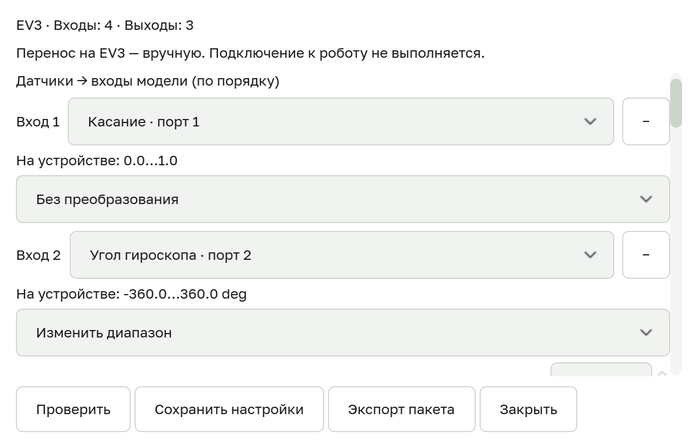
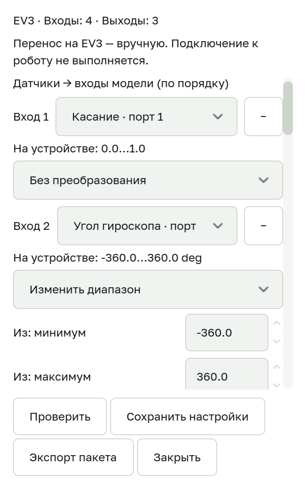

# Локальный экспорт EV3

Маршрут доступен из окна «Экспорт»: «EV3 · Настроить и экспортировать…». Нужна локально обученная модель и установленный Python runtime. Этот этап создаёт комплект файлов; подключение к EV3 и запуск моторов из интерфейса не выполняются.

## Настройка

1. Выберите модель в существующем окне экспорта и откройте EV3.
2. Сопоставьте каждый вход модели с датчиком в порядке обучающих колонок. Укажите преобразование диапазона датчика в диапазон входа модели.
3. Выберите моторы и правило преобразования ответа: отдельный выход, наиболее вероятный класс или порог. Проверьте значения команд.
4. Нажмите «Проверить». Ошибки размеров, каналов и числовых параметров должны быть исправлены.
5. «Сохранить настройки» сохраняет проверенную конфигурацию для проекта, модели и конкретных обученных весов. Закрытие отменяет несохранённые изменения. Переобученная модель требует повторной настройки и проверки.
6. Выберите родительскую папку и имя новой подпапки. Подтвердите проверку диапазонов и экспортируйте комплект. Существующие папки и файлы не заменяются.

Начальные настройки не доказывают соответствие обучающим данным: сохранённой достоверной сигнатуры диапазонов обучения пока нет. Текущие строки редактируемого датасета не выдаются за диапазоны, на которых модель действительно обучалась. Особенно проверьте назначение нескольких выходов: argmax подходит для классификации, но не заменяет независимые регрессионные выходы.

## Комплект

- `model.onnx` — конкретные проверенные веса модели.
- `neuralese_robot.py` — программа для EV3 с ev3dev.
- `robot_config.json` — датчики, преобразования и моторы.
- `HOW_TO_USE.txt` — инструкции и ограничения.

Нейросеть выполняется на компьютере; программа EV3 обменивается показаниями и командами по TCP через сетевой интерфейс USB. Экспорт не устанавливает прошивку и не переносит файлы на устройство. Интерфейс живого подключения остаётся отдельным этапом.

## Целостность

Экспорт собирается во временной папке. При ошибке исходная модель и выбранные существующие файлы сохраняются. Одинаковый путь нельзя перезаписать повторным экспортом. SHA-256 модели проверяется до экспорта и после копирования; замена модели во время операции даёт ошибку. ONNX с внешними файлами весов в этом маршруте отклоняется — поддержан самостоятельный файл.

## Проверка и ограничения

Основной headless-прогон: 117 Godot-сценариев прошли. Отложенный тест нативного захвата окна дополнительно выполнен после освобождения GUI и также прошёл. Неожиданных ошибок движка нет (отрицательный тест autosave печатает ожидаемую ошибку недоступного каталога). Python suites: 130 passed, 1 skipped, 42 subtests passed; реестр и 21 сгенерированная сцена прошли.

Robot suites: 167 passed, 0 skipped — 136 проверок логики, 18 тестов с заглушками micro:bit/SPIKE и 13 проверок EV3 на настоящей библиотеке ev3dev2 с fake sysfs и loopback-соединением. В том числе проверены watchdog при открытом сокете без новых команд и попытка остановить оставшиеся моторы после ошибки остановки одного. Это не физическое оборудование.

Реальный локальный сценарий Godot → обучение на 48 синтетических строках (38 в train split) → предсказание → ONNX → форма EV3 → сохранение/повторное открытие → экспорт комплекта завершился с кодом 0 без ошибок. Веса в комплекте совпадают по SHA-256. Проверены отказ перезаписи занятой папки и отказ при смене модели. ONNX checker прошёл; разница предсказаний Godot и экспортированной модели — 0.0. Это проверка интеграции, а не качества модели.

Форма проверена headless, включая геометрию 375 px, точность сохранённых диапазонов, отмену, восстановление после ошибок и защиту клавиатуры родительского окна. Независимый критик проверил код. Дополнительная нативная проверка выполнена после освобождения GUI: обычное окно и ширина 375 px, прокрутка параметров, сохранение, Escape, повторное открытие и реальный экспорт. Исправлены тёмный фон отдельного окна, выход полей за правую границу и тесные отступы кнопки EV3 в родительском окне. Нативный сценарий завершился с кодом 0 без ошибок.

 Реальный EV3, перенос программы, физическая остановка и движение моторов в этом этапе не проверяются. Серверные токены не используются.
