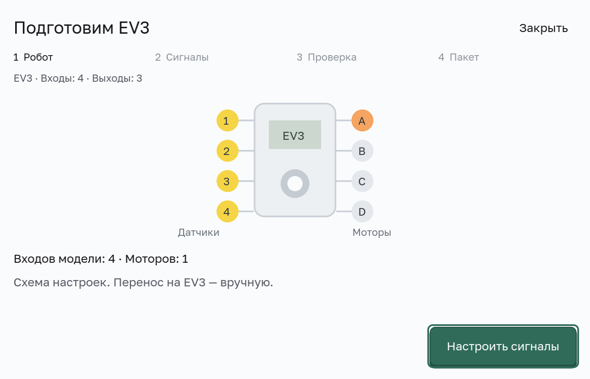
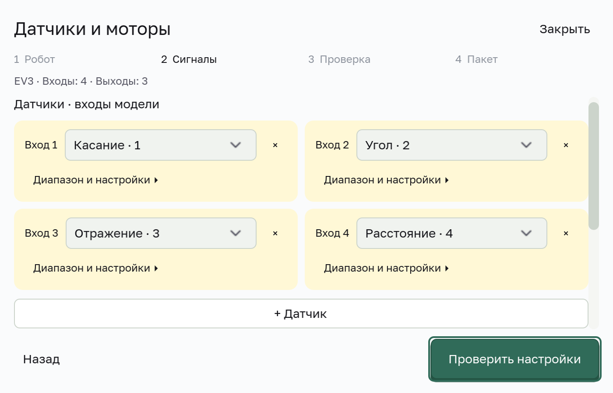
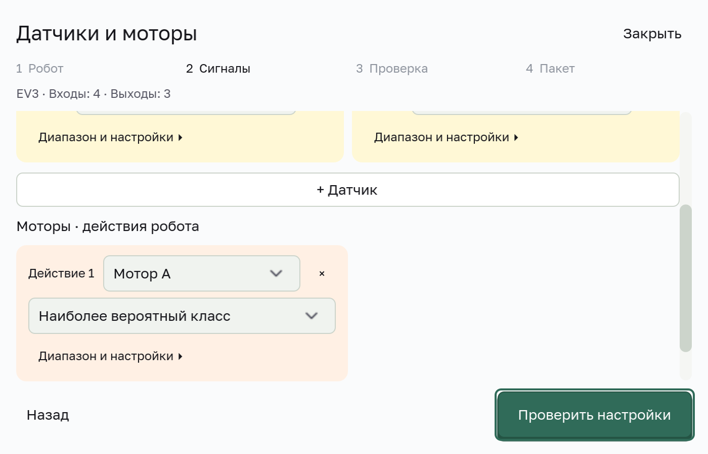
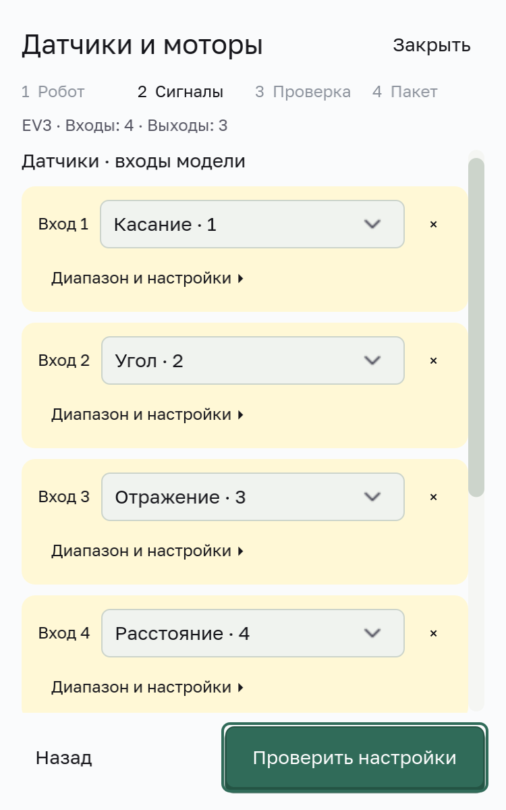

# Локальный экспорт EV3

Маршрут доступен из окна «Экспорт»: «EV3 · Настроить и экспортировать…». Нужна локально обученная модель и установленный Python runtime. Этот этап создаёт комплект файлов; подключение к EV3 и запуск моторов из интерфейса не выполняются.

## Настройка

1. Выберите модель в существующем окне экспорта и откройте EV3.
2. **«Робот» — устройство и порты.** Проверьте выбранные датчики и моторы, их порты и порядок входов модели. Кнопка «Настроить сигналы» ведёт к настройке преобразований.
3. **«Сигналы» — сопоставление.** Настройте компактные карточки входов и моторов. Диапазоны и подробные числовые параметры раскрываются по необходимости. Для мотора выберите отдельный выход, наиболее вероятный класс или порог, затем проверьте команды.
4. **«Проверка».** Просмотрите итоговое сопоставление и запустите проверку. Ошибки размеров, каналов и числовых параметров блокируют переход к экспорту. Подтвердите, что диапазоны датчиков и команды моторов проверены по обучающим данным. Возврат назад позволяет изменить настройки; после правки нужны повторная проверка и подтверждение.
5. **«Пакет» — экспорт.** Выберите родительскую папку и имя новой подпапки, затем создайте комплект. Существующие папки и файлы не заменяются. После ошибки можно исправить назначение и повторить экспорт. После успеха окно показывает путь и инструкцию ручного переноса. «Готово» закрывает окно, «Создать ещё» возвращает к выбору назначения.

На каждом шаге основная кнопка предлагает следующее действие; «Назад» возвращает к предыдущему шагу. Проверенные настройки можно сохранить для проекта, модели и конкретных обученных весов. Закрытие окна или Escape отменяет несохранённые изменения; повторное открытие начинает маршрут с первого шага и загружает сохранённую конфигурацию. Переобученная модель требует повторной настройки и проверки.
Начальные настройки не доказывают соответствие обучающим данным: сохранённой достоверной сигнатуры диапазонов обучения пока нет. Текущие строки редактируемого датасета не выдаются за диапазоны, на которых модель действительно обучалась. Особенно проверьте назначение нескольких выходов: argmax подходит для классификации, но не заменяет независимые регрессионные выходы.

## Комплект

- `model.onnx` — конкретные проверенные веса модели.
- `neuralese_robot.py` — программа для EV3 с ev3dev.
- `robot_config.json` — датчики, преобразования и моторы.
- `HOW_TO_USE.txt` — инструкции и ограничения.

Нейросеть выполняется на компьютере; программа EV3 обменивается показаниями и командами по TCP через сетевой интерфейс USB. Экспорт не устанавливает прошивку и не переносит файлы на устройство. Интерфейс живого подключения остаётся отдельным этапом.

## Целостность

Экспорт собирается во временной папке. При ошибке исходная модель и выбранные существующие файлы сохраняются. Одинаковый путь нельзя перезаписать повторным экспортом. SHA-256 модели проверяется до экспорта и после копирования; замена модели во время операции даёт ошибку. ONNX с внешними файлами весов в этом маршруте отклоняется — поддержан самостоятельный файл.

## Проверка и ограничения

Headless-сценарий `tests/godot/test_robot_export_dialog.gd` использует намеренную заглушку runtime. Он проверяет переходы между шагами и блокировку при ошибках, раскрытие параметров, геометрию окна шириной 375 px, точность сохранённых диапазонов, отмену и повторное открытие, восстановление после ошибки экспорта, состояние успешного завершения и защиту клавиатуры родительского окна. Дополнительно вызывается настоящий глобальный стилизатор: цвет карточек и компактный размер полей должны сохраняться после его отложенной обработки. Заглушка не доказывает обучение модели или работоспособность комплекта на устройстве.

Реальный локальный интеграционный сценарий и нативные снимки окна проверяются отдельно. SHA-256 модели должен совпадать с весами, использованными при проверке; изменение весов требует повторного открытия и проверки. Реальный EV3, перенос программы, физическая остановка и движение моторов в этом этапе не проверяются. Серверные токены не нужны.

## Нативные экраны и проверка 22 октября 2026

Снимки получены из настоящих окон Godot, с локально обученной моделью на синтетических данных. Проверены обучение, предсказание, остановка обучения, ONNX и создание комплекта EV3 с совпадающим SHA-256; сохранение, отмена и повторное открытие настроек. Все 118 зарегистрированных проверок Godot прошли, Python: 130 passed, 1 skipped, 42 subtests; каталог и 21 сгенерированный узел также проверены. После последних правок текста и сброса состояния повторно пройдены целевой EV3 regression test и нативный сценарий. Это не проверка физического робота.
